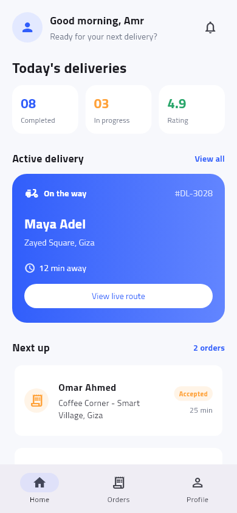
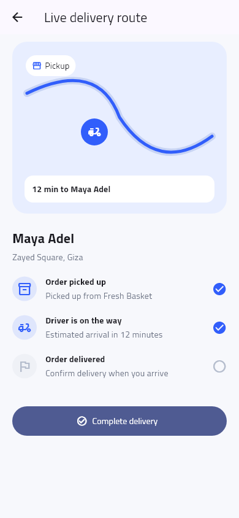

# Delivery Driver App

A self-contained Flutter portfolio demo for a delivery-driver workflow. It presents an active delivery, order queue, profile screen, and an interactive route-tracking experience without requiring a backend or third-party keys.

## Preview

<p align="center">
  
  
</p>

## Features

- Driver dashboard with delivery metrics and order queue.
- Active-order card and order status handling.
- Interactive route-tracking screen with delivery progress steps.
- Delivery-completion feedback flow.
- Responsive Material 3 interface designed for a delivery workflow.

## Tech Stack

- **Framework:** Flutter
- **UI:** Material 3
- **Navigation:** Flutter Navigator
- **Data Source:** Local demo data
- **Route Preview:** Custom Flutter painting

## Project Structure

```text
lib/
└── main.dart       # Demo data, screens, reusable UI, and route preview
```

## Setup

Run locally with no additional services or configuration:

```bash
flutter pub get
flutter run
```

## Key Learning Areas

- Modeling a delivery workflow using focused, reusable Flutter UI components.
- Designing a readable mobile dashboard and delivery-tracking experience.
- Creating an interactive route visual without exposing API keys or external configuration.
- Keeping a portfolio demo simple to run and easy to review.

## Author

Built by [Amr Khafagy](https://github.com/amr-khafagy), Flutter Developer and Mobile Application Engineer.
